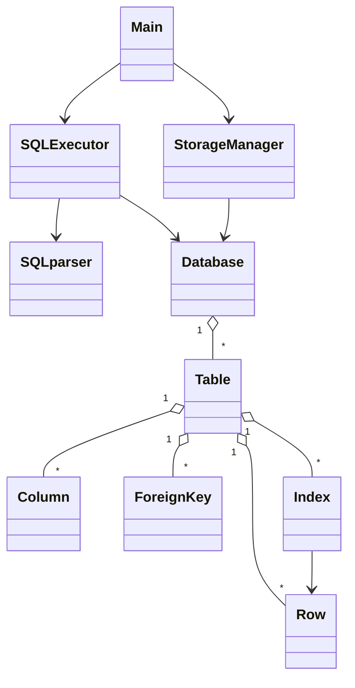
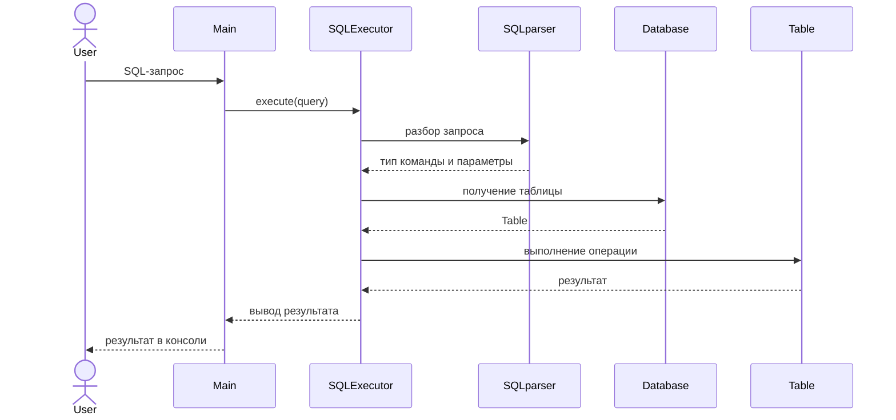

# JavaDB — упрощённая СУБД

## 1. Архитектура

Программа состоит из четырёх основных частей:

- `core` — модели базы данных: таблицы, строки, столбцы, типы данных и внешние ключи.
- `sql` — разбор и выполнение SQL-подобных команд.
- `index` — индекс на основе `TreeMap`, ускоряющий поиск по столбцу.
- `storage` — сохранение и загрузка базы данных с помощью сериализации Java.

### Диаграмма классов



### Диаграмма последовательности выполнения запроса



## 2. Индексы и производительность

Индекс реализован с помощью `TreeMap`: ключом является значение индексируемого столбца, а значением — список соответствующих строк. Он поддерживает поиск по точному значению и диапазону.

Для условий `=`, `>`, `>=`, `<`, `<=` программа может использовать индекс. Для `!=` выполняется обычный просмотр строк.

| Операция поиска | Без индекса | С индексом |
|---|---:|---:|
| Поиск по точному значению | O(n) | O(log n + k) |
| Поиск по диапазону | O(n) | O(log n + k) |

`n` — количество записей, `k` — количество найденных записей. Индекс ускоряет поиск, но требует дополнительной памяти и обновления при добавлении, изменении и удалении записей.

## 3. Запуск программы

1. Запустить `Main.java`.
2. При первом запуске программа создаёт пустую базу данных.
Таблицы пользователь создаёт самостоятельно с помощью команды CREATE TABLE. При последующих запусках программа загружает сохранённую базу данных из database.dat.
3. При следующих запусках данные загружаются из `database.dat`.
4. Для завершения ввести `exit`.

Если после изменения структуры классов появляется сообщение об устаревшем формате `database.dat`, удалите этот файл (если его данные не нужны) и запустите программу заново.

## 4. Примеры команд

```sql
-- Просмотр записей
SELECT * FROM clubs;
SELECT * FROM events WHERE department_id = 1;

-- Добавление записи
INSERT INTO clubs (id, name, budget, created_at, active)
VALUES (3, 'Music Club', 25000.0, '2026-11-15', true);

-- Изменение записи
UPDATE clubs SET budget = 40000.0 WHERE id = 3;

-- Удаление записи
DELETE FROM events WHERE id = 2;

-- Создание индекса
CREATE INDEX idx_event_date ON events (event_date);

-- Удаление индекса
DROP INDEX idx_event_date ON events;

-- Создание таблицы
CREATE TABLE rooms (id INTEGER PRIMARY KEY, name STRING, capacity INTEGER);

-- Удаление таблицы
DROP TABLE rooms;
```

Внешний ключ `events.department_id` ссылается на `clubs.id`, поэтому для добавления мероприятия сначала должна существовать соответствующая запись клуба.

## 5. Сохранение данных

После команд, изменяющих базу данных, программа сохраняет её в файл `database.dat`. При следующем запуске данные восстанавливаются автоматически.
